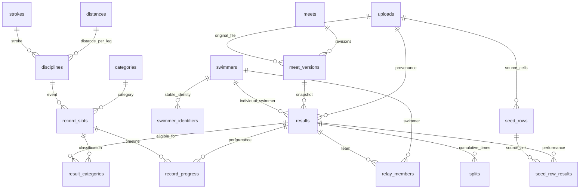

# Database and import rules

## Relational model

`disciplines` distinguishes stroke, per-swimmer distance, number of swimmers and special composition variant. Gender belongs to the result/record slot. A 4×100 medley, an individual 400 medley and an 8×50 mixed-age freestyle format are different disciplines even if total distances match.

`categories` has data-driven age bounds rather than an age column on every result. `record_slots` is the unique combination of discipline, category and gender. `result_categories` lets one result qualify for several slots. `record_progress` is a rebuildable projection of normalized results and classifications; it is not an independent editable claim. Each slot has separate timelines and current records for `SCM` (25m) and `LCM` (50m), partitioned by `results.course`. History requests use both slot ID and course. All Excel baselines are classified as SCM.

`swimmer_identifiers` separates stable license/Swimrankings IDs from export-local athlete IDs. Matching preference is stable ID, then one unambiguous normalized name/gender/birth-date match. Conflicting stable IDs or dates abort the import. Unknown Excel birthdays remain null. The raw LENEX athlete IDs are used only to resolve that document's relay references.

`uploads.content` stores the exact original bytes as a BLOB. The SHA-256 digest supports content-based idempotency. `meet_versions` has a partial unique index guaranteeing one active revision per meet. Old results are never deleted on a normal correction: only their parent version is deactivated. Sports-data reset is the explicit destructive exception.

All times are integer hundredths of seconds. Raw/derived result kinds are separate: `race`, `seed`, `split`, and a reserved `lead_off` kind. Derived splits reference their parent race. Cumulative split times are also retained in `splits`; they are not confused with individual lap durations.

## Seed flow

1. Read the workbook and verify every populated birth-year/competition-year matrix cell against the year-age rule.
2. Locate event headings in each independent column group. Individual sheets use A/I; relays use A/G/M.
3. Normalize stroke spelling, distance, relay count and category. Keep special mixed-relay descriptions as discipline variants.
4. Create slots even when no baseline time has been set.
5. Normalize only unambiguous punctuation errors in times; use Excel date serials/typed dates in UTC. Retain textual seasons as unknown exact dates.
6. Separate shared holders in one source row. Consolidate repeated performances across senior/all-age rows. Preserve each source row and its exact values through a junction to performances.
7. Assign only the categories explicitly claimed by the sheet. Do not derive birth years from a record row's age: birthdays, spelling errors and coholders make that unsafe.
8. Replay record candidates, report workbook inconsistencies, and commit the archive atomically.

`reset --yes` performs clear + seed in the same transaction after loading/validating the workbook matrix. Mid-import failure rolls back the old archive. Credentials, settings, stroke definitions and category definitions are preserved.

## LENEX flow

1. Reject uploads larger than 10 MB. Plain `.lef`/`.xml` documents are accepted; `.lxf` is a ZIP container.
2. Examine ZIP entry metadata before decompression, accepting exactly one XML/LEF document up to 40 MB uncompressed. No archive entry is extracted to disk. DTD/entity declarations are rejected, then XML syntax is validated.
3. Find clubs whose `code` exactly equals the global setting. An export without that club is rejected without changes; absence is not interpreted as deletion.
4. Identify each meet, session and event. The actual race date comes from its session, and the actual course comes from the session/meet, never `entrycourse` (which describes the entry qualifying time).
5. Store the original file and start a new revision for each matching meet. All old revisions for those meets become inactive within the same transaction.
6. Resolve Tempo athletes and relay members. Save every race result, including DSQ/DNS/other statuses. Invalid/missing time on a nominally successful result aborts the import; zero DSQ times are represented as null.
7. Assign categories using race-year age. Store all cumulative splits. Only valid freestyle splits at the workbook's record distances (25, 50, 100, 200, 300, 400, 600, 800, 1500, 2000m) can generate shorter-distance candidates. Preserve other split distances without creating new club-record events.
8. Validate relay order and member references. Complete ordinary relays use oldest youth age, all-adult senior eligibility and all-age eligibility. Incomplete teams receive no automatic eligibility; special mixed-age variants require explicit composition knowledge.
9. Exclude non-OK results and non-meter courses from record replay, without discarding those results from storage.
10. Recalculate history and current records from all active revisions plus baseline claims, then commit. Any failure rolls everything back.

An identical file with every meet version still active is a duplicate no-op, even if its filename differs. Re-uploading a previously superseded file intentionally creates another revision; it restores that snapshot and remains auditable.

The format details follow the primary [LENEX technical specification](https://wiki.swimrankings.net/images/6/62/Lenex_3.0_Technical_Documentation.pdf). `SWIMSTYLE.distance` is per relay swimmer, not the total team distance, and `relaycount=1` denotes an individual event. Both supplied exports were tested directly.

## Record replay

Candidates are grouped by slot, then sorted by race date and event start time. Undated seed seasons form an explicitly undated baseline. For each slot:

1. Its first known valid performance is a baseline/first record.
2. A strictly faster time is an improvement, with the previous best stored for display.
3. An equal time creates a shared record event.
4. A slower time remains a result but does not create a record event.
5. Current holders are all accepted events equal to the fastest known time.

When the exact swimmer/date/time appears in both Excel and LENEX, it is one performance for the slot, not a duplicate tie. Different swimmers or distinct performances on different dates remain represented. A correction that invalidates a former best restores the prior valid holders and recomputes subsequent improvements. Import order cannot change the chronological result.

The upload summary distinguishes newly awarded current records belonging to the new upload from changes that merely restore an older performance. One swim can create multiple allocations, e.g. age 16 and all-age.

## HTTP boundaries

Public endpoints expose names and performances, not birth dates, license numbers, contact details or raw XML. Admin routes require an expiring session stored by hashed token. Passwords use salted scrypt hashes. Cookies are HttpOnly/SameSite Strict; `COOKIE_SECURE=true` is available for HTTPS. Mutations require a custom request header, reject cross-origin browser requests, and do not enable CORS. Login attempts are rate-limited. Original-file downloads are admin-only.

SSE invalidates browser read models after a web import or settings change. SQLite uses `data_version`; MySQL polls a shared revision counter incremented in the same transaction as imports and settings changes. These polls catch commits made by CLI processes or other app instances. Browser clients automatically reconnect and show connection state.
